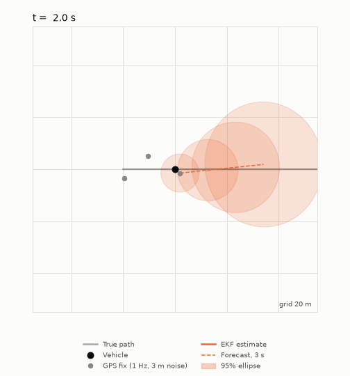
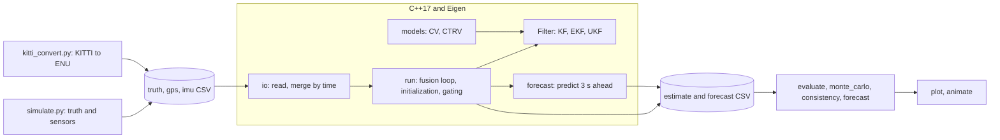
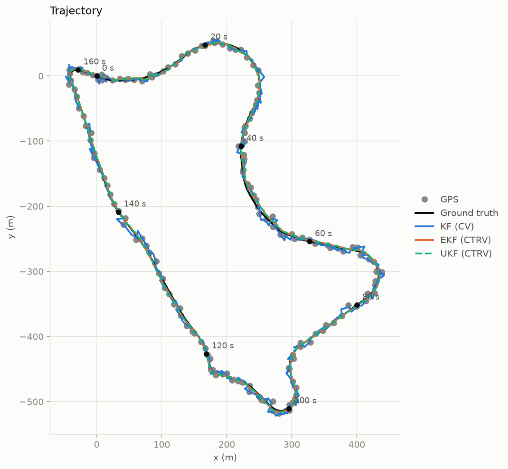
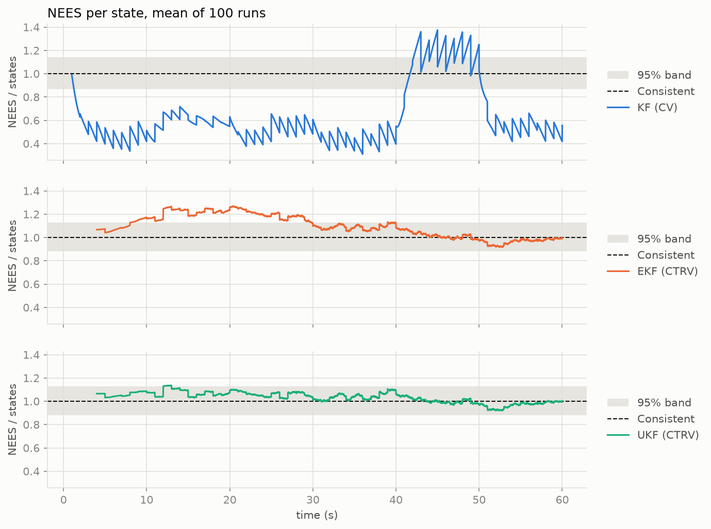
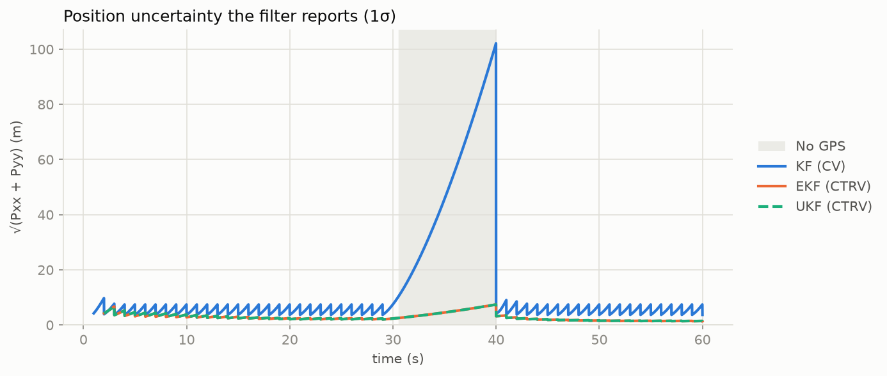
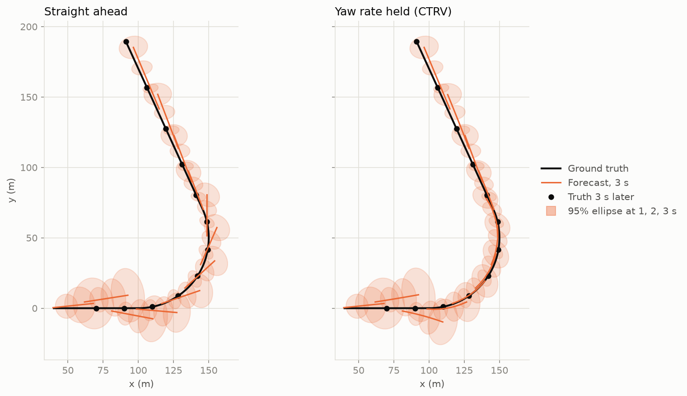

# Vehicle state estimation: fusing GPS and IMU with KF, EKF and UKF



A GPS receiver is slow and noisy; an IMU is fast but drifts. This project fuses
the two to estimate the position, speed and heading of a vehicle, and forecasts
where it will be three seconds later, with a calibrated uncertainty.

The filters are written from scratch in C++17 with Eigen. Python generates the
data, evaluates the results and draws the plots.

## The problem

| Sensor | Rate | What goes wrong with it |
| --- | --- | --- |
| GPS position | 1 Hz | 3 m of noise per fix, occasional outliers, outages |
| IMU: forward acceleration and yaw rate | 100 Hz | noise, and a gyro bias that makes the heading drift |

The filter has to report, at 100 Hz, where the vehicle is and how sure it is of
that. Being honest about the uncertainty matters as much as being accurate:
everything downstream, from outlier rejection to forecasting, depends on it.

Three filters are compared:

- **KF (CV)**: a linear Kalman filter with a constant-velocity model. It uses GPS only.
- **EKF (CTRV)**: an extended Kalman filter with a constant turn rate and velocity
  model. The IMU drives the prediction, GPS corrects it. State: `[x, y, v, heading, gyro bias]`.
- **UKF (CTRV)**: an unscented Kalman filter with the same model and state.

## Architecture



| Path | Contents |
| --- | --- |
| `cpp/include/models/` | The motion models: transition functions, Jacobians, process noise |
| `cpp/include/filters/`, `cpp/src/` | The common `Filter` interface and the three filters |
| `cpp/src/run.cpp` | The fusion loop: asynchronous IMU and GPS, initialization, gating and restart |
| `cpp/src/forecast.cpp` | Prediction ahead without measurements |
| `cpp/tests/` | 66 unit tests (GoogleTest) |
| `python/simulate.py`, `python/kitti_convert.py` | The two data sources, writing the same CSV format |
| `python/evaluate.py`, `monte_carlo.py`, `consistency.py`, `tune.py`, `forecast.py` | Evaluation |
| `results/` | Plots, the tables behind every number below, and the animation |

The C++ side reads CSV files and writes CSV files, so the filters do not know
whether the data is simulated or recorded.

## Results

All errors are position RMSE in metres. "At GPS fixes" compares everything at
the instants where a GPS fix exists, which is the only place raw GPS can be
compared; "all samples" uses every 100 Hz output of a filter.

### Simulator, 200 Monte Carlo runs

| | at GPS fixes | all samples | in turns | µs per step |
| --- | --- | --- | --- | --- |
| Raw GPS | 4.21 | – | – | – |
| KF (CV) | 3.57 | 5.01 | 5.68 | 0.25 |
| EKF (CTRV) | 2.12 | 2.37 | 2.25 | 0.17 |
| UKF (CTRV) | 2.11 | 2.35 | 2.24 | 0.75 |

With three times sharper turns (0.6 rad/s) the constant-velocity filter falls
apart, 10.88 m in turns, while the EKF and UKF stay under 2 m.

### KITTI, three sequences

The recorded RTK-GPS/INS solution is the ground truth. The GPS the filters see is
that solution thinned to 1 Hz with 3 m of white noise added; the IMU channels
are used as recorded. Each row pools 20 noise realisations.

| Sequence | Raw GPS | KF (CV) | EKF (CTRV) | UKF (CTRV) | EKF vs raw GPS |
| --- | --- | --- | --- | --- | --- |
| 2011_09_30_drive_0027 (used for tuning) | 4.20 | 3.50 | 1.84 | 1.83 | −56% |
| 2011_09_30_drive_0033 (held out) | 4.20 | 3.51 | 1.90 | 1.91 | −55% |
| 2011_09_30_drive_0034 (held out) | 4.20 | 3.47 | 1.93 | 1.94 | −54% |



### Is the filter as sure as it should be? NEES and NIS

If a filter's covariance matches its real errors, the normalised estimation
error squared (NEES) averages to the number of states, and the normalised
innovation squared (NIS) of a GPS fix to 2. Over 100 runs, with the gyro bias
drawn from the prior the filters assume:

| | NEES per state | time inside the 95% band | NIS per dimension | fixes inside the band |
| --- | --- | --- | --- | --- |
| KF (CV) | 0.63 | 7% | 0.82 | 15% |
| EKF (CTRV) | 1.10 | 61% | 0.96 | 95% |
| UKF (CTRV) | 1.03 | 98% | 0.96 | 95% |



The EKF and the UKF have almost the same RMSE, but not the same honesty: the EKF
is overconfident while the heading and bias are still uncertain, and the UKF is
not. The constant-velocity filter cannot be consistent with one fixed process
noise, because the vehicle alternates between driving straight and turning.

### GPS outage

Ten seconds without GPS. The plot shows the position uncertainty each filter
reports: it grows while GPS is gone and collapses when it returns.



| RMSE during the outage (m), 200 runs | |
| --- | --- |
| KF (CV) | 24.12 |
| EKF (CTRV) | 5.17 |
| UKF (CTRV) | 5.14 |

### Outliers and gating

5% of the GPS fixes are displaced by 30 m. A fix is rejected when its squared
Mahalanobis distance from the predicted measurement exceeds the 99% chi-square
gate (9.21).

| RMSE at GPS fixes (m), 200 runs | without gate | with gate |
| --- | --- | --- |
| Raw GPS | 7.89 | – |
| KF (CV) | 6.55 | 5.19 |
| EKF (CTRV) | 4.60 | 2.27 |
| UKF (CTRV) | 4.58 | 2.26 |

### Forecasting 3 s ahead

A forecast copies the filter and predicts on without measurements. ADE is the
displacement error averaged over the horizons 0.5 to 3 s, FDE the error at 3 s.
The 95% ellipse is checked the same way as the filter: it should contain the
true position 95% of the time.

| Simulator, 50 runs | ADE | FDE | FDE in turns | truth inside the 95% ellipse at 3 s |
| --- | --- | --- | --- | --- |
| KF (CV) | 11.24 | 17.80 | 28.01 | 94% |
| Straight ahead from the EKF state | 4.26 | 7.63 | 12.04 | 77% |
| Yaw rate held (CTRV), EKF | 3.20 | 4.79 | 4.05 | 95% |
| Yaw rate and acceleration held, EKF | 2.91 | 3.98 | 4.07 | 96% |

On KITTI, holding the yaw rate gives an ADE of 2.6 to 3.0 m and an FDE of 4.1 to
4.9 m. The ellipses, tuned on one sequence, are cautious on the two others
(98% and 100% at 3 s).



## How to run

Requirements: a C++17 compiler, CMake, Eigen 3, GoogleTest, and Python 3 with
the packages in `python/requirements.txt`. On macOS:

```bash
brew install cmake eigen googletest
python3 -m venv .venv && source .venv/bin/activate
pip install -r python/requirements.txt
```

Everything, in one command (about 7 minutes, 10 with KITTI):

```bash
./run_all.sh            # simulator
./run_all.sh --kitti    # also downloads 40 MB of KITTI data and evaluates on it
```

Or step by step:

```bash
cmake -S cpp -B build && cmake --build build && ctest --test-dir build
python python/simulate.py                     # data/sim/{truth,gps,imu}.csv
for f in kf ekf ukf; do build/main $f; done   # data/sim/estimate_<filter>.csv
python python/evaluate.py                     # RMSE table
python python/plot.py                         # results/*.png
```

`build/main` without arguments lists its options; the simulator takes
`--gps_outage 30 40`, `--outlier_rate 0.05`, `--turn_rate 0.6` and `--seed`.

## Lessons learned

1. **A badly tuned filter is worse than no filter.** With too little process
   noise the constant-velocity filter is worse than the raw GPS it smooths.
   Too little is far more dangerous than too much (`results/tuning.png`).
2. **The textbook process noise breaks when the time step varies.** The common
   `dt⁴/4` form gives a different covariance for one 2 s step than for two 1 s
   steps. The continuous form `dt³/3` does not; a unit test pins this down.
3. **The gyro bias has to be in the state.** A bias of 0.01 rad/s turns the
   heading by 34° in a minute. Without estimating it the EKF is worse than raw GPS.
4. **One seed proves nothing.** One of the first ten runs diverged: noise made
   the first two GPS fixes point backwards, and the filter settled on the
   mirrored solution (negative speed, heading off by π), which fits GPS equally well.
5. **NEES finds bugs that RMSE hides.** It showed that the initial covariance
   ignored the correlation between position and velocity, and that the test
   itself was wrong until the truth was drawn from the filter's own prior.
6. **Gating needs a way out.** Gating assumes the filter is right and the
   measurement wrong. When an outlier landed among the initialising fixes, the
   filter rejected every good fix afterwards. It now reports nothing until it
   has accepted a fix, and restarts after three rejections in a row.
7. **Simulator settings do not transfer to real data.** On KITTI, dead reckoning
   drifts three to six times faster than the simulator's noise levels predict,
   partly because the model ignores side slip. The noise was retuned on one
   sequence and checked on two others.
8. **A forecast ellipse means nothing until it is checked.** Straight from the
   filter covariance, the 95% ellipse held the truth 61% of the time at 3 s: it
   described sensor noise, not what the driver might do next.

## Limitations

- The KITTI "GPS" is synthetic: the recorded solution thinned to 1 Hz with white
  noise. Real GPS errors are correlated in time.
- On KITTI the IMU channels and the ground truth come from the same fused
  RTK-GPS/INS unit, so the results are optimistic compared with a standalone IMU.
- On the two held-out KITTI sequences the filters are still overconfident
  (NEES per state about 1.9, against 11 before tuning). White noise does not
  capture the correlated errors of real data.
- The model is planar and has no side slip. Initialisation needs the vehicle to
  cover about 21 m, so it takes longer at low speed.
- The forecast extrapolates the vehicle's own motion. It does not predict
  behaviour, and its ADE/FDE are not comparable with learned trajectory predictors.

## Data

The simulator needs no data. The KITTI part uses the OXTS recordings of the
[KITTI raw dataset](https://www.cvlibs.net/datasets/kitti/raw_data.php),
licensed CC BY-NC-SA 3.0. `data/download_kitti.py` fetches only the GPS/IMU
folders; the data itself is not part of this repository.

> A. Geiger, P. Lenz, C. Stiller, R. Urtasun. Vision meets Robotics: The KITTI
> Dataset. International Journal of Robotics Research, 2013.
